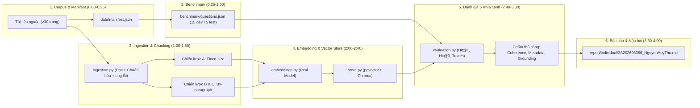

# Kế hoạch Thực hiện (Implementation Plan) — Day 06: Data Ingestion Engineering

> Kế hoạch này bám sát toàn bộ yêu cầu trong [GUIDE.md](GUIDE.md), lộ trình 240 phút của [CHECKPOINTS.md](CHECKPOINTS.md), 5 tiêu chí đánh giá tại [BENCHMARK.md](BENCHMARK.md), quy tắc trung thực trong [RULES.md](RULES.md) và thang điểm 100 tại [RUBRIC.md](RUBRIC.md).

---

## 1. Kiến trúc Tổng thể & Luồng Công việc



---

## 2. Chi tiết các Giai đoạn theo Checkpoints

### Giai đoạn 1 — Checkpoint `0:25`: Chọn Dữ liệu, Tạo Manifest & Setup Hạ tầng (8 điểm Rubric)

#### Mục tiêu
Chuẩn bị bộ dữ liệu hợp lệ tối thiểu **30 trang nội dung thực**, lập manifest đầy đủ và khởi chạy thành công hạ tầng Vector Store + Embedding Model.

#### Công việc cần làm
1. **Chuẩn bị Corpus (`starter/data/` hoặc `data/`):**
   - Chọn tài liệu công khai có giấy phép rõ ràng (ví dụ: Sổ tay học vụ/sinh viên, tài liệu kỹ thuật phần mềm, báo cáo thường niên hoặc sách OpenStax).
   - **Kiểm tra điều kiện ≥30 trang:**
     - Nếu là PDF: Đếm số trang thực tế có nội dung sau khi loại bỏ bìa, mục lục, trang trống, tài liệu tham khảo.
     - Nếu là HTML/Markdown/Text: Tối thiểu 30 đơn vị nguồn độc lập hoặc chia tuần tự thành các đơn vị có **≥1.500 ký tự sau chuẩn hóa**.
   - Đảm bảo tài liệu có cấu trúc phân đoạn/tiêu đề và ít nhất **1 trường metadata dùng để lọc** (`section`, `category`, `year`, `version`, hoặc `document_type`) có từ 2 giá trị phân biệt trở lên.
2. **Tạo `data/manifest.json`:**
   - Lưu các trường bắt buộc: `source_id`, `title`, `source_path_or_url`, `license_or_permission`, `accessed_at`, `total_physical_pages`, `valid_page_ids`, `page_counting_rule`, `total_normalized_chars`.
3. **Thiết lập môi trường & Kiểm tra Hạ tầng:**
   - Khởi tạo môi trường ảo Python và cài đặt thư viện từ [starter/requirements.txt](starter/requirements.txt) cùng thư viện embedding.
   - Khởi chạy PostgreSQL + `pgvector` bằng Docker Compose ([starter/docker-compose.yml](starter/docker-compose.yml)) và xác nhận bằng [starter/scripts/check_setup.py](starter/scripts/check_setup.py) trả về `Setup OK`.

#### Minh chứng hoàn thành (Deliverables)
- [ ] Thư mục dữ liệu gốc và file `data/manifest.json`.
- [ ] Kết quả chạy `python starter/scripts/check_setup.py` hiển thị `Setup OK`.

---

### Giai đoạn 2 — Checkpoint `1:00`: Xây dựng Bộ Câu hỏi Benchmark & Gold Evidence (10 điểm Rubric)

> **Lưu ý quan trọng:** Theo [RULES.md](RULES.md), bộ câu hỏi, cách chia `dev`/`test` và tiêu chí chọn chiến lược **phải được chốt trước khi chạy thử nghiệm**. Không chỉnh sửa chiến lược dựa trên kết quả của tập `test`.

#### Mục tiêu
Xây dựng tối thiểu **20 câu hỏi** có bằng chứng xác thực từ corpus, tách sẵn **15 câu `dev`** và **5 câu `test`**.

#### Công việc cần làm
1. **Soạn thảo `benchmark/questions.json`** (theo cấu trúc mẫu tại [data/format-example.json](data/format-example.json)):
   - Tổng số câu: ≥20 câu (`15 dev` / `5 test`).
   - Bao phủ các dạng câu hỏi:
     - `truc_tiep` (Direct lookup)
     - `dien_dat_lai` (Paraphrased)
     - `dieu_kien_ngoai_le` (Conditional / Exception)
   - Có ít nhất **3 câu hỏi gắn `filter` metadata** (ví dụ `{"section": "..."}` hoặc `{"year": 2025}`), trong đó có **ít nhất 2 câu ở `dev` và 1 câu ở `test`**.
   - Mỗi câu gồm đầy đủ: `id`, `split`, `type`, `question`, `expected_answer`, `gold_source_id`, `gold_page` (hoặc danh sách các trang hợp lệ), `evidence_quote`, và `filter` (nếu có).
2. **Viết script kiểm chứng Gold Evidence tự động:**
   - Xác nhận mọi `evidence_quote` đều tồn tại thực sự trong trang `gold_page` của tài liệu sau khi chuẩn hóa.
3. **Ghi trước giả thuyết và tiêu chí lựa chọn:**
   - Cập nhật giả thuyết cho chiến lược A, B, C vào [artifacts/experiment_log.csv](artifacts/experiment_log.csv).
   - Quy định rõ quy tắc chọn cấu hình tốt nhất trên tập `dev` (ví dụ: Ưu tiên `Evidence Hit@3` cao nhất trên `dev` → tiếp theo là `Hit@1` → `Coherence` trung bình → số lượng chunk/thời gian).

#### Minh chứng hoàn thành (Deliverables)
- [ ] File `benchmark/questions.json` với ≥20 câu hỏi đã kiểm chứng evidence.
- [ ] File [artifacts/experiment_log.csv](artifacts/experiment_log.csv) được điền phần thiết kế cấu hình và giả thuyết.

---

### Giai đoạn 3 — Checkpoint `1:50`: Đọc, Chuẩn hóa Tài liệu & Hiện thực 2 Chiến lược Chunking (12 điểm Rubric)

#### Mục tiêu
Hoàn thiện module đọc/chuẩn hóa dữ liệu có ghi log trang lỗi và hiện thực hai phương pháp chia chunk có kiểm soát.

#### Công việc cần làm
1. **Hoàn thiện [starter/src/ingestion.py](starter/src/ingestion.py):**
   - `normalize_text(text: str) -> str`:
     - Chuẩn hóa Unicode về dạng `NFC`.
     - Loại bỏ ký tự rác/control characters, gộp khoảng trắng thừa trên cùng một dòng nhưng **giữ nguyên ngắt đoạn (`\n\n`) và cấu trúc tiêu đề**.
   - `load_pdf(path: Path, document_id: str, source: str) -> list[DocumentPage]` (hoặc hàm đọc corpus tương ứng):
     - Trích xuất từng trang vật lý, gắn `document_id`, `source`, `page` và trích xuất tự động metadata hữu ích (`section`, `category`, `year`, v.v.).
     - Phát hiện trang trống, trang bìa, mục lục hoặc trang lỗi không trích xuất được chữ; ghi chi tiết vào `results/ingestion_log.json`.
2. **Hoàn thiện [starter/src/chunking.py](starter/src/chunking.py):**
   - `fixed_size(page: DocumentPage, size: int = 500, overlap: int = 50) -> list[Chunk]` (Dùng cho **Chiến lược A**):
     - Chia văn bản theo cửa sổ ký tự cố định (`size=500`, `overlap=50`).
     - Sinh `chunk_id` tất định (deterministic, ví dụ: `{strategy}_{document_id}_p{page}_c{idx}`).
   - `by_paragraph(page: DocumentPage, max_size: int = 600) -> list[Chunk]` (Dùng cho **Chiến lược B & C**):
     - Tách và gom các đoạn văn/tiêu đề theo ranh giới tự nhiên (`\n\n` hoặc heading) sao cho mỗi chunk không vượt quá `max_size`. Nếu một đoạn đơn lẻ dài hơn `max_size`, tách nhỏ theo câu.
     - Giữ nguyên toàn bộ metadata từ `DocumentPage` sang `Chunk`.

#### Minh chứng hoàn thành (Deliverables)
- [ ] Code hoàn chỉnh trong [starter/src/ingestion.py](starter/src/ingestion.py) và [starter/src/chunking.py](starter/src/chunking.py).
- [ ] File `results/ingestion_log.json` và thống kê số lượng chunk, phân bố độ dài chunk của cấu hình A và B.

---

### Giai đoạn 4 — Checkpoint `2:40`: Embedding, Vector Store & Chạy 3 Chiến lược (20 điểm Rubric)

#### Mục tiêu
Kết nối model embedding thật, lưu trữ bền vững vào Vector Store hỗ trợ tìm kiếm Cosine + lọc metadata, đảm bảo nạp lại không trùng lặp và thực thi đủ 3 cấu hình A, B, C.

#### Công việc cần làm
1. **Hoàn thiện [starter/src/embeddings.py](starter/src/embeddings.py):**
   - Hiện thực `MyEmbedder` sử dụng model thật (ví dụ: `sentence-transformers/paraphrase-multilingual-MiniLM-L12-v2` với 384 chiều chạy local, hoặc API embedding).
   - Kiểm tra nghiêm ngặt: nếu model/API lỗi thì dừng và báo ngoại lệ rõ ràng, **tuyệt đối không fallback sang vector giả/ngẫu nhiên**.
2. **Hoàn thiện [starter/src/store.py](starter/src/store.py):**
   - `create_schema()`: Tạo bảng lưu trữ có cột `embedding vector(dimensions)`, `strategy`, `chunk_id`, `document_id`, `source`, `page`, `text`, `metadata JSONB` với khóa chính `PRIMARY KEY (strategy, chunk_id)`.
   - `upsert(strategy, chunks, vectors)`:
     - Kiểm tra khớp số lượng và số chiều vector.
     - Xóa các chunk cũ không còn tồn tại của cùng `(strategy, document_id)` (xử lý trường hợp tài liệu nguồn thay đổi) và dùng `INSERT ... ON CONFLICT (strategy, chunk_id) DO UPDATE` để nạp lại không nhân đôi.
   - `search(strategy, query_vector, top_k=3, filters=None)`:
     - Truy vấn theo khoảng cách Cosine (`embedding <=> %s::vector`).
     - Tham số hóa an toàn điều kiện lọc metadata trên JSONB (`metadata @> %s::jsonb`) khi `filters` được truyền vào.
3. **Thiết lập 3 Chiến lược có kiểm soát trong [starter/src/run.py](starter/src/run.py):**
   - **Chiến lược A:** Chunk `fixed_size(size=500, overlap=50)` + Truy xuất **không dùng filter**.
   - **Chiến lược B:** Chunk `by_paragraph(max_size=600)` + Truy xuất **không dùng filter** *(chỉ thay đổi phương pháp chunk so với A)*.
   - **Chiến lược C:** Chunk `by_paragraph(max_size=600)` (dùng cùng tập chunk/embedding như B) + Truy xuất **có áp dụng metadata filter** cho những câu hỏi có trường `filter` *(chỉ thay đổi đúng 1 yếu tố lọc metadata so với B)*.
   - Đo và ghi lại thời gian ingest, tổng ký tự, số chunk, chi phí API (0 nếu chạy local) và kiểm tra thực nghiệm nạp lại lần 2 không làm tăng số bản ghi.

#### Minh chứng hoàn thành (Deliverables)
- [ ] Code hoàn chỉnh trong [starter/src/embeddings.py](starter/src/embeddings.py), [starter/src/store.py](starter/src/store.py), [starter/src/run.py](starter/src/run.py).
- [ ] File thống kê ingest và log kiểm chứng idempotency (nạp lại không trùng) tại `results/ingest_stats.json`.

---

### Giai đoạn 5 — Checkpoint `3:30`: Chạy Benchmark & Đánh giá 5 Khía cạnh (35 điểm Rubric)

#### Mục tiêu
Thu thập đầy đủ trace top-3 cho mọi câu hỏi ở cả 3 chiến lược, tính chỉ số định lượng trên `dev`/`test` và thực hiện chấm thủ công 3 hạng mục (Coherence, Metadata, Grounding).

#### Công việc cần làm
1. **Hoàn thiện [starter/src/evaluation.py](starter/src/evaluation.py) & Lưu Trace:**
   - Với mỗi câu hỏi và mỗi chiến lược (A, B, C), truy xuất top-3 chunks và lưu vào `results/traces.json`.
   - Tính **Khía cạnh 1 — Retrieval Accuracy (`Hit@1` và `Evidence Hit@3`):**
     - Một chunk được tính là hit khi thuộc đúng `gold_source_id`, `gold_page` hợp lệ và chứa đủ thông tin bằng chứng (`evidence_quote` hoặc bằng chứng tương đương được xác nhận).
     - Tổng hợp kết quả tách biệt cho tập `dev` (trên 15 câu) và tập `test` (trên 5 câu), báo rõ dạng phân số `n/N` và tỷ lệ `%`.
2. **Thực hiện Audit / Chấm thủ công 4 khía cạnh còn lại:**
   - **Khía cạnh 2 — Chunk Coherence (`results/manual_coherence.csv`):**
     - Chọn cố định 10 vị trí nội dung nguồn (ví dụ 10 trang đầu tiên theo thứ tự ID).
     - Chấm thủ công các chunk bao phủ 10 vị trí đó trên A, B, C theo thang `0–2` (`0`: cắt giữa ý/mất chủ thể; `1`: hiểu một phần/thiếu ngữ cảnh; `2`: trọn vẹn, tự hiểu được) kèm giải thích lý do và điểm trung bình `/2`.
   - **Khía cạnh 3 — Metadata Usefulness (`results/manual_metadata_audit.csv`):**
     - Kiểm tra thủ công 5 câu `test` × top-3 = 15 kết quả cho mỗi chiến lược: đối chiếu `source`, `page` và trường lọc với tài liệu gốc, báo tỷ lệ `n/15` bản ghi đủ và đúng.
     - Tính tỷ lệ tuân thủ filter (`n/N`) trên các câu hỏi có `filter`. Phân tích 1 lợi ích thực tế và 1 hạn chế của trường metadata đã chọn.
   - **Khía cạnh 4 — Grounding Quality (`results/manual_grounding.csv`):**
     - Trên 5 câu `test` của mỗi chiến lược, chấm tổ hợp top-3 theo thang `0–2` (`0`: không có bằng chứng; `1`: có bằng chứng nhưng thiếu điều kiện/ngoại lệ; `2`: đủ bằng chứng trả lời và truy nguồn). Báo số câu ở từng mức `0/1/2` và điểm trung bình `/2` kèm lý do.
   - **Khía cạnh 5 — Data Strategy Impact:**
     - So sánh có kiểm soát giữa **A vs. B** (tác động của chunking) và **B vs. C** (tác động của metadata filter) về độ chính xác, tính mạch lạc, số chunk, thời gian và các ca lỗi điển hình.

#### Minh chứng hoàn thành (Deliverables)
- [ ] `results/traces.json` và `results/metrics_summary.json`.
- [ ] Các bảng chấm thủ công: `results/manual_coherence.csv`, `results/manual_metadata_audit.csv`, `results/manual_grounding.csv`.

---

### Giai đoạn 6 — Checkpoint `4:00`: Hoàn thiện Báo cáo Cá nhân & Kiểm tra Nộp bài (15 điểm Rubric)

#### Mục tiêu
Hoàn tất toàn bộ hồ sơ bài nộp theo đúng cấu trúc quy định tại [SUBMISSION.md](SUBMISSION.md) và mẫu [REPORT_TEMPLATE.md](REPORT_TEMPLATE.md).

#### Công việc cần làm
1. **Điền thông tin & Nhật ký thí nghiệm:**
   - Cập nhật đầy đủ [STUDENT.md](STUDENT.md) (Họ và tên: Nguyễn Huy Thư, MSSV: `2A202603356`, Lớp: `L3A`).
   - Điền kết quả `dev_hit1`, `dev_hit3`, `test_hit1`, `test_hit3` và ghi chú vào [artifacts/experiment_log.csv](artifacts/experiment_log.csv).
2. **Viết Báo cáo Cá nhân (`report/individual/2A202603356_NguyenHuyThu.md`):**
   - Sao chép khung từ [report/individual/MSSV_HoTen.md](report/individual/MSSV_HoTen.md) và điền đầy đủ 4 phần:
     1. *Dữ liệu và pipeline* (chủ đề, giấy phép, quy tắc tính trang, chuẩn hóa, model/store/chi phí, metadata).
     2. *Cấu hình và benchmark* (tham số A/B/C, bộ 20 câu hỏi 15 dev / 5 test, tiêu chí chọn chốt trước khi xem test).
     3. *Kết quả* (2 bảng tổng hợp định lượng & định tính, đường dẫn tới trace và file nhãn thủ công).
     4. *Phân tích và kết luận* (so sánh A–B và B–C, phân tích chi tiết **ít nhất 2 ví dụ sai cụ thể** kèm ID câu hỏi và trang nguồn, lý do chọn chiến lược cuối cùng, hạn chế mẫu nhỏ/thiên lệch người chấm, và hướng cải tiến như Hybrid Retrieval BM25 + Dense).
3. **Cập nhật [README.md](README.md) & Rà soát Checklist [SUBMISSION.md](SUBMISSION.md):**
   - Bổ sung hướng dẫn cài đặt và lệnh chạy tái lập kết quả từ đầu đến cuối.
   - Đảm bảo không commit file `.env` chứa API key hoặc dữ liệu nhạy cảm.

---

## 3. Cấu trúc Thư mục Đích sau khi Hoàn thành

```text
K5-L3A-Day06-NguyenHuyThu-2A202603356-DataIngestionEngineering/
├── STUDENT.md                                    # Thông tin học viên đã điền đầy đủ
├── README.md                                     # Hướng dẫn setup và lệnh chạy tái lập
├── IMPLEMENTATION_PLAN.md                        # File kế hoạch thực hiện chi tiết
├── data/
│   ├── manifest.json                             # Manifest nguồn, giấy phép, danh sách ≥30 trang hợp lệ
│   └── <corpus_files>                            # Tài liệu nguồn được phép sử dụng
├── benchmark/
│   └── questions.json                            # ≥20 câu hỏi (15 dev / 5 test) kèm gold evidence & filter
├── artifacts/
│   └── experiment_log.csv                        # Nhật ký thí nghiệm A, B, C đầy đủ số liệu
├── results/
│   ├── ingestion_log.json                        # Log các trang đọc thành công / trang rỗng / bị loại
│   ├── ingest_stats.json                         # Thống kê số chunk, độ dài, thời gian, idempotency check
│   ├── traces.json                               # Toàn bộ kết quả truy xuất top-3 của A, B, C
│   ├── metrics_summary.json                      # Tổng hợp Hit@1, Evidence Hit@3 theo dev/test
│   ├── manual_coherence.csv                      # Bảng chấm thủ công 10 vị trí nguồn × 3 chiến lược
│   ├── manual_metadata_audit.csv                 # Bảng kiểm tra metadata 5 câu test × top-3
│   └── manual_grounding.csv                      # Bảng chấm thủ công grounding 5 câu test × 3 chiến lược
├── report/
│   └── individual/
│       └── 2A202603356_NguyenHuyThu.md           # Báo cáo cá nhân hoàn chỉnh theo mẫu
└── starter/
    ├── docker-compose.yml                        # PostgreSQL 16 + pgvector
    ├── requirements.txt                          # Danh sách thư viện kèm phiên bản
    └── src/
        ├── models.py
        ├── ingestion.py                          # Đọc & chuẩn hóa Unicode
        ├── chunking.py                           # Fixed-size (A) & Paragraph/Structure (B, C)
        ├── embeddings.py                         # Kết nối Embedding model thật
        ├── store.py                              # Lưu trữ pgvector, upsert không trùng, search + filter
        ├── evaluation.py                         # Tính Hit@1, Evidence Hit@3 và xuất trace
        └── run.py                                # Điểm vào chạy trọn vẹn pipeline & benchmark
```

